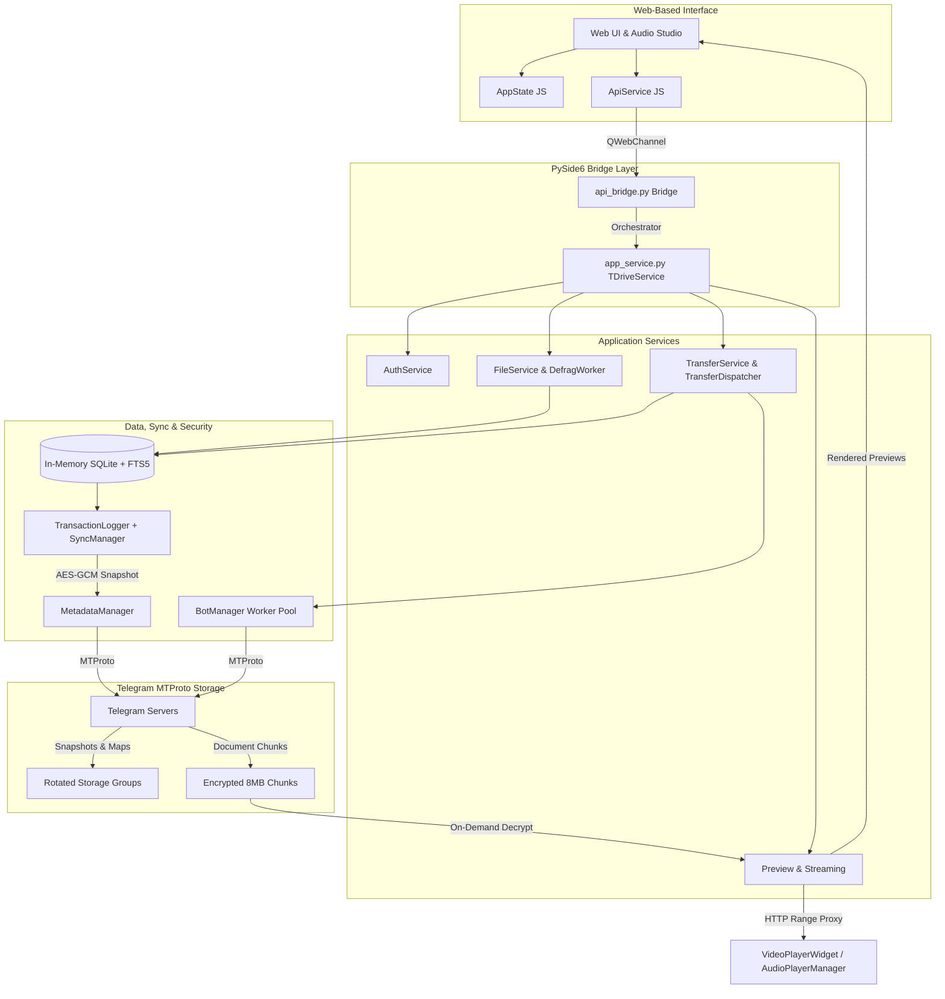

# 🚀 TDrive: Telegram-Powered Unlimited Cloud Storage

[](LICENSE)
[](https://www.python.org/)
[](https://www.qt.io/qt-for-python)

**TDrive** is a desktop cloud drive client built on Telegram's unlimited message storage. It turns Telegram private groups and worker bots into a **theoretically infinite, end-to-end encrypted, and free** private cloud file system with desktop-native media streaming and previews.

---

## ✨ Key Features

### 📂 Unlimited Storage, High-Speed Transfers & Smart Sync
*   **Infinite Capacity**: Powered by the Telegram MTProto protocol (Telethon), utilizing private Telegram groups for file storage without capacity limits.
*   **Intelligent Chunking & Deduplication**: Automatically splits large files into encrypted 8 MB chunks and identifies identical files via cryptographic hashes so duplicate uploads link instantly without re-uploading.
*   **Multi-Group Storage Rotation & Worker Bot Pool**: Automatically rotates storage groups with 64-bit bit-packed global message IDs (`encode_global_msg_id` / `decode_global_msg_id`) and distributes transfers across a pool of Telegram worker bots (`BotManager` + `TransferDispatcher`) for parallel throughput and rate-limit resilience.
*   **Crash-Safe WAL & Background Defragmentation**: `TransactionLogger` persists write operations to `pending_ops.bin` for crash recovery, while `DefragWorker` periodically consolidates fragmented folder metadata in the background.

### 🔐 Bank-Grade Security
*   **End-to-End Encryption (E2EE)**: All file chunks, folder maps, and database snapshots are AES-256 encrypted locally before leaving your device. Keys remain exclusively on your machine; Telegram cannot read your data.
*   **Hardware-Bound Keys**: Session data and sensitive credentials are protected using `keyring` and your unique hardware ID (`py-machineid`) to prevent unauthorized access across devices.

### 📺 Multimedia Streaming & Multi-Format Previews
*   **Instant Video Streaming**: Built-in `aiohttp` HTTP Range proxy (`VideoStreamer` + `StreamBuffer`) streams and decrypts video chunks on demand into a native bundled VLC widget (`VideoPlayerWidget`) with instant seeking.
*   **Audio Streaming & Music Studio**: Headless VLC-backed audio streaming (`AudioPlayerManager`) paired with a 3-stage progressive Audio Studio UI (mini bar, floating bar, full studio window), pre-buffering, and local playlist management (`PlaylistManager`).
*   **Document, Image & Code Previews**:
    *   **Documents (`DocumentPreviewer`)**: Built-in PDF and Office document viewer powered by PyMuPDF and bundled headless LibreOffice.
    *   **Text & Code (`TextPreviewer`)**: Paginated, windowed text viewer with automatic encoding detection (`chardet`) and syntax highlighting (`highlight.js`).
    *   **Images & Gallery (`ImagePreviewer`, `ThumbnailManager`)**: Memory-optimized gallery thumbnails synced to the cloud and LRU-cached progressive 1080p image previews.

### 🖥️ Modern Desktop UX
*   **External OS Drag-and-Drop**: Drag files and folders directly from your operating system's file explorer into TDrive to queue uploads immediately.
*   **Themes & Localization**: Configurable light and dark theme palettes alongside built-in `zh-TW` (default) and `en-US` internationalization.
*   **Advanced Transfer Queue**: Global pause/resume controls, configurable transfer concurrency (1–10 concurrent tasks), and drag-and-drop task reordering (`PrioritySemaphore`).

---

## 🚀 Quick Start

### Standalone Executable
TDrive can be packaged and distributed as a standalone executable (`TDrive.exe`) with no Python setup required.

1. Download the latest `TDrive.exe` package from the Releases page.
2. Obtain your own Telegram API credentials at [**my.telegram.org**](https://my.telegram.org):
   1. Log in with your Telegram account and open **"API development tools"**.
   2. Create a new application (any title/short name, e.g., `MyTDrive`) to obtain your **`App api_id`** and **`App api_hash`**.
3. Launch `TDrive.exe`, enter your API credentials, and sign in via QR Code or Phone Number.

### Running from Source & Building
1. Ensure Python **3.10+** is installed and create/activate a virtual environment:
   ```bash
   python -m venv venv
   venv\Scripts\activate
   ```
2. Install pinned dependencies from [requirements.txt](requirements.txt):
   ```bash
   pip install -r requirements.txt
   ```
3. Run the application:
   ```bash
   python main.py
   ```
4. (Optional) Build a standalone package with PyInstaller using [TDrive.spec](TDrive.spec):
   ```bash
   pyinstaller TDrive.spec
   ```

---

## 🏗️ Technical Architecture

TDrive combines a PySide6 (`QtWebEngineWidgets`) desktop shell, a Python `asyncio` + `qasync` backend, and an HTML/JS/CSS frontend connected over `QWebChannel`.

### 1. The "Cloud-as-Database" Model
*   **In-Memory DB (`DatabaseConnection`)**: Folder hierarchies, file mappings, trash records, and FTS5 full-text search indexes live in a thread-safe (`RLock`) `:memory:` SQLite singleton. Bulk mutations use the `batch_write()` context manager to coalesce WAL fsyncs and sync notifications.
*   **Adaptive Sync & Crash Recovery (`SyncManager` & `TransactionLogger`)**: `SyncManager` applies an adaptive score-based debounce before scheduling cloud snapshots, while `TransactionLogger` appends writes to `file/user_data/pending_ops.bin` so un-synced edits replay cleanly after unexpected exits.
*   **Cloud Snapshots & Multi-Group Indexing (`MetadataManager`)**: Periodically, on shutdown, and after mutations, the database state and folder map files are compressed, AES-GCM encrypted, and saved across rotated Telegram storage groups using bit-packed global message IDs.
*   **Instant Recovery**: On login, TDrive retrieves and decrypts the latest cloud snapshot to restore the entire virtual drive directory in milliseconds.

### 2. Frontend-Backend Bridge Layer
The web UI (`web/`) communicates with Python via `QWebChannel` (`window.tdrive_bridge` ↔ `api_bridge.py` `Bridge` `@Slot`s → `app_service.py` `TDriveService`):
*   **`_callBridge`** → `_async_call` / `_wait_for_async`: Blocks on a local `QtEventLoop` for quick reads/sync operations, guarded by an `_is_busy` mutex to prevent re-entrant deadlocks.
*   **`_callBridgeSignal`** → `_run_background_task`: Dispatches long-running transfers and preview fetches asynchronously and delivers results via Qt signals.
*   **`_fireAndForget`** → `_fire_and_forget`: Triggers backend actions that require no return payload.

### 3. Media Streaming, Previews & Transfer Engine
*   **Local HTTP Range Proxy (`VideoStreamer` & `StreamBuffer`)**: An `aiohttp` loopback server handles HTTP `Range` requests with session-token validation. `StreamBuffer` fetches, decrypts, and LRU-caches 8 MB MTProto chunks with dynamic readahead for both `VideoPlayerWidget` and `AudioPlayerManager`.
*   **Multi-Format Preview Pipeline**: `DocumentPreviewer` (PyMuPDF + bundled headless LibreOffice), `TextPreviewer` (256 KB windowed decoding via `chardet`, two-tier memory/SQLite `PreviewCacheManager`, and vendored `highlight.js`), and `ImagePreviewer` (200 MB LRU cache + 1080p previews).
*   **Transfer Engine & UI Progress Throttling**: `TransferService` (`PrioritySemaphore`, `UploadStrategy`, `DownloadStrategy`) coordinates with `TransferDispatcher` and `BotManager` for parallel chunk transfers. `_create_progress_adapter` in `TDriveService` throttles progress signals to at most once every 0.03 seconds while always emitting critical status transitions (`completed`, `failed`, `cancelled`, `paused`, `queued`, `transferring`).

### System Flow Diagram


---

## 🛡️ Privacy Statement

Your data privacy is our absolute priority:
*   TDrive **does not** collect or store any user data on its own servers.
*   All data transfers happen directly between your device and official Telegram servers.
*   Encryption keys are generated locally and are never shared with third parties.

---

## 📄 License

This project is licensed under the MIT License. See the [LICENSE](LICENSE) file for details.
